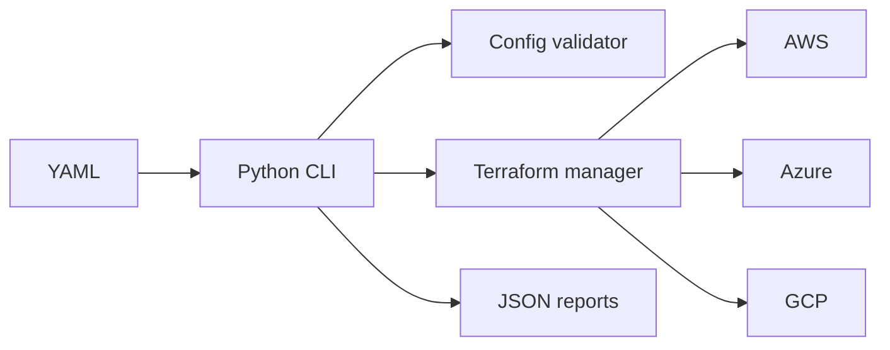

# CloudPilot

CloudPilot is a provider-independent starter platform for validating YAML infrastructure definitions and safely orchestrating Terraform across AWS, Azure, and Google Cloud.

## Quick start

```powershell
py -3.11 -m venv .venv
.venv\Scripts\Activate.ps1
pip install -r requirements.txt
python main.py validate --config config\dev.yaml
pytest
```

`plan`, `deploy`, `status`, and `destroy` require Terraform and provider-native authentication. Destruction requires `--yes`.

## Architecture



Credentials must come from environment variables, profiles, workload identity, or cloud-native authentication. Never commit secrets or state files.

## Local UI demo (no cloud account required)

Run the local dashboard with mock data:

```powershell
python ui\server.py
```

Open [http://127.0.0.1:8080](http://127.0.0.1:8080). The dashboard supports local configuration validation and a simulated Terraform plan. It does not use cloud credentials or create resources.

## Phase 1 API

Install the API dependencies and run the local backend:

```powershell
pip install -r requirements.txt
python -m backend.run
```

Open [http://127.0.0.1:8000/docs](http://127.0.0.1:8000/docs) for the API explorer.
The API currently provides health, demo state, configuration validation, and a
Terraform plan preview. The preview never executes Terraform. See
[DEVELOPMENT_STATUS.md](./DEVELOPMENT_STATUS.md) and
[docs/architecture.md](./docs/architecture.md).

### Local authentication

The Phase 2 API stores local data in `cloudpilot.db` by default. Register and
login through `/docs`; sessions use an HTTP-only cookie. Verification and
password-reset links are logged by the development email adapter rather than
sent externally. Set `CLOUDPILOT_DATABASE_URL` to use PostgreSQL.

## React frontend

In a second PowerShell window:

```powershell
cd frontend
npm install
npm run dev
```

Open [http://127.0.0.1:5173](http://127.0.0.1:5173). Start the FastAPI backend
first so dashboard data and local authentication are available. The dashboard
shows explicit empty states until real provider integrations are implemented.
Use the same hostname for both services when testing sessions: open
`http://localhost:5173` with the backend at `http://localhost:8000`, or open
`http://127.0.0.1:5173` with the backend at `http://127.0.0.1:8000`.

### Simulated cloud accounts

Sign in or create a local account, then select **Accounts**. You can connect
sample AWS, GCP, or Azure metadata, run simulated verification, and disconnect
the account. No passwords, permanent keys, cloud APIs, or real resources are
used. The API routes are under `/api/cloud-accounts`.

### Infrastructure templates

Select **Browse templates** in the React dashboard to open the local template
marketplace. The wizard supports provider, region, VM, machine type, CIDR, and
subnet configuration, then saves the configuration to the local database.
Terraform is not executed during this workflow.

### Local cost comparison

Select **Compare costs** to calculate sample AWS, GCP, and Azure estimates.
Fixture values are labeled in the UI and include assumptions, regions, and
retrieval timestamps in the API response. They are not live prices or billing
data.

### Terraform preview

Select **Terraform preview** in the sidebar to generate provider-specific
`main.tf`, `variables.tf`, `outputs.tf`, and `terraform.tfvars.example` files.
The local MVP does not run Terraform `init`, `plan`, or `apply` from this
workflow.

### Simulated deployments

Select **Deployments** to create a local plan, explicitly approve simulated
provisioning, view generated resource IDs, and simulate destroy. Reports are
written to `reports/`. No cloud resources are created.
