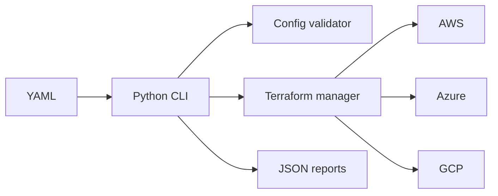

# CloudPilot

CloudPilot is a provider-independent starter platform for validating YAML infrastructure definitions and safely orchestrating Terraform across AWS, Azure, and Google Cloud.

## Quick start

```powershell
py -3.11 -m venv .venv
.venv\Scripts\Activate.ps1
pip install -r requirements.txt
python main.py validate --config config\dev.yaml
pytest
```

`plan`, `deploy`, `status`, and `destroy` require Terraform and provider-native authentication. Destruction requires `--yes`.

## Architecture



Credentials must come from environment variables, profiles, workload identity, or cloud-native authentication. Never commit secrets or state files.

## Local UI demo (no cloud account required)

Run the local dashboard with mock data:

```powershell
python ui\server.py
```

Open [http://127.0.0.1:8080](http://127.0.0.1:8080). The dashboard supports local configuration validation and a simulated Terraform plan. It does not use cloud credentials or create resources.

## Phase 1 API

Install the API dependencies and run the local backend:

```powershell
pip install -r requirements.txt
python -m backend.run
```

Open [http://127.0.0.1:8000/docs](http://127.0.0.1:8000/docs) for the API explorer.
The API currently provides health, demo state, configuration validation, and a
Terraform plan preview. The preview never executes Terraform. See
[DEVELOPMENT_STATUS.md](./DEVELOPMENT_STATUS.md) and
[docs/architecture.md](./docs/architecture.md).

### Local authentication

The Phase 2 API stores local data in `cloudpilot.db` by default. Register and
login through `/docs`; sessions use an HTTP-only cookie. Verification and
password-reset links are logged by the development email adapter rather than
sent externally. Set `CLOUDPILOT_DATABASE_URL` to use PostgreSQL.

## React frontend

In a second PowerShell window:

```powershell
cd frontend
npm install
npm run dev
```

Open [http://127.0.0.1:5173](http://127.0.0.1:5173). Start the FastAPI backend
first so dashboard data and local authentication are available. The dashboard
shows explicit empty states until real provider integrations are implemented.
Use the same hostname for both services when testing sessions: open
`http://localhost:5173` with the backend at `http://localhost:8000`, or open
`http://127.0.0.1:5173` with the backend at `http://127.0.0.1:8000`.

The current Command Center uses a dark-first operations layout with a
collapsible sidebar, light/dark theme toggle, provider overview cards, and
local API snapshot filters. Monitoring and billing values remain unavailable or
explicitly estimated until corresponding integrations are connected; the UI
does not represent local demo data as live cloud telemetry.

The **Discovery** workspace provides a searchable inventory of connected
accounts and verified capability metadata, including regions, machine types,
and supported resource capabilities. It does not claim resource-level
discovery until provider inventory APIs are integrated.

The provisioning marketplace supports blueprint search and category filtering.
Its guided wizard validates basic inputs before saving a local configuration;
it does not request credentials or execute Terraform.

FinOps comparison displays local fixture estimates with monthly/annual ranges,
provider breakdowns, and assumptions. It is not connected to provider billing
 APIs and must not be treated as an invoice or live price feed.

 The Architecture Builder now presents a topology summary and clickable
 component inspector. This remains a configuration-derived local preview, not
 provider resource inventory or live network telemetry.

 The Command Center also includes Operations Pulse and Recommended Next Steps
 panels. These use only local API and account metadata; live monitoring,
 incident, and provider telemetry remain unavailable until integrations are
 added.

### Simulated cloud accounts

Sign in or create a local account, then select **Accounts**. You can connect
sample AWS, GCP, or Azure metadata, run simulated verification, and disconnect
the account. No passwords, permanent keys, cloud APIs, or real resources are
used. The API routes are under `/api/cloud-accounts`.

The default provider mode is simulation. AWS read-only STS verification can be
enabled explicitly with `CLOUDPILOT_PROVIDER_MODE=real`; it uses the AWS
default credential chain, an optional profile, or an optional IAM role ARN.
The API never accepts permanent AWS secret keys. Azure uses
`DefaultAzureCredential`; GCP uses application default credentials. Provider
SDKs and credentials remain optional when simulation mode is active.

### Infrastructure templates

Select **Browse templates** in the React dashboard to open the local template
marketplace. The wizard supports provider, region, VM, machine type, CIDR, and
subnet configuration, then saves the configuration to the local database.
Terraform is not executed during this workflow.

### Local cost comparison

Select **Compare costs** to calculate sample AWS, GCP, and Azure estimates.
Fixture values are labeled in the UI and include assumptions, regions, and
retrieval timestamps in the API response. They are not live prices or billing
data.

### Terraform preview

Select **Terraform preview** in the sidebar to generate provider-specific
`main.tf`, `variables.tf`, `outputs.tf`, and `terraform.tfvars.example` files.
The local MVP does not run Terraform `init`, `plan`, or `apply` from this
workflow.

Reusable provider stack modules live under `terraform/modules/` and are
consumed by the legacy `providers/aws`, `providers/gcp`, and `providers/azure`
entrypoints. Validate an entrypoint locally with:

```powershell
terraform -chdir=providers/aws init -backend=false
terraform -chdir=providers/aws validate
```

The AWS entrypoint requires `ami_id`; the Azure entrypoint requires
`ssh_public_key`. These modules are validation-ready foundations, not an
authorization grant to provision cloud resources.

An API plan can be enabled only explicitly with
`CLOUDPILOT_TERRAFORM_PLAN_ENABLED=true`. It requires a real-mode verified
cloud account and runs Terraform `init` plus `plan` with backend disabled;
there is no apply or destroy endpoint.

Deployment history persists lifecycle events and exposes authenticated log
retrieval at `/api/deployments/{id}/logs`. The `after_id` query parameter
returns only newer events for polling clients.

Live clients can use `/api/deployments/{id}/logs/stream` as an authenticated
Server-Sent Events stream. Streams emit `log`, `complete`, and bounded
`timeout` events; reconnect with the last event ID using `after_id`.

Real plan output can be attached to a deployment with
`POST /api/deployments/{id}/terraform-plan` and an organization-owned,
successfully real-verified `account_id`. Terraform output is sanitized before
being persisted as deployment logs. This endpoint remains plan-only.

Authenticated deployment history shows **Real plan** only for deployments
whose provider has a successfully real-verified account. The UI combines plan
execution with the SSE log stream and keeps simulated approval/destroy
controls separate.

Before Terraform starts, backend preflight checks account-discovered regions,
machine types, and network/compute capabilities. Failed plan jobs can be
retried from deployment history after the underlying issue is corrected.

Deployment history can be filtered by provider and status. Cloud account
cards show discovered region and machine-type coverage when available.

### Simulated deployments

Select **Deployments** to create a local plan, explicitly approve simulated
provisioning, view generated resource IDs, and simulate destroy. Reports are
written to `reports/`. No cloud resources are created.

### Admin console

Set `CLOUDPILOT_ADMIN_EMAIL` before registering a local account to bootstrap
that account as an administrator. If the account already exists, restarting the
backend with the matching email promotes it in local development. The
dashboard then shows **Admin console**.
Admin routes enforce authorization in the backend; frontend navigation alone
cannot grant access.

## Docker Compose

For a repeatable local stack with PostgreSQL:

```powershell
$env:CLOUDPILOT_ADMIN_EMAIL="admin@example.com"
docker compose up --build
```

Open [http://localhost:5173](http://localhost:5173). The API is available at
[http://localhost:8000/docs](http://localhost:8000/docs). Stop the stack with
`docker compose down`; add `-v` only if you intentionally want to remove the
local PostgreSQL volume.

Docker Compose is optional. The lower-resource Windows workflow remains:

```powershell
python -m backend.run
cd frontend
npm run dev
```

The SQLite database is intended for lightweight development. Docker Compose
uses PostgreSQL through `CLOUDPILOT_DATABASE_URL`; the backend initializes its
local MVP schema before serving requests. This is not a replacement for
versioned production migrations.
