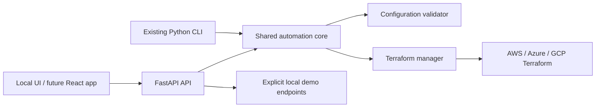

# CloudPilot architecture

## Phase 1 architecture

The current FastAPI endpoints are intentionally limited to health, configuration
validation, and a Terraform plan preview. The preview does not execute Terraform
or contact a cloud provider. The existing CLI remains the path for explicit
Terraform operations.

## Target architecture

Future phases will add a React/TypeScript frontend, PostgreSQL persistence,
tenant-scoped authorization, Redis-backed jobs, provider account verification,
pricing adapters, and deployment approval workflows. Those components are not
represented as functional integrations until implemented and tested.
